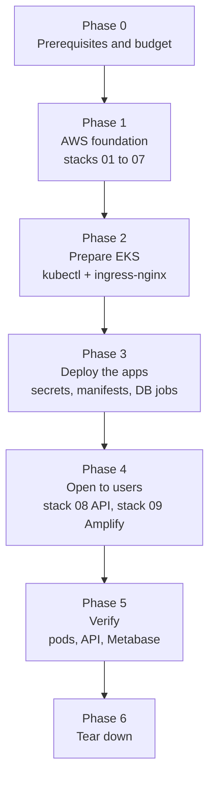

# Wonderland Cloud Platform

Cloud native theme park platform built for **SE6020 – Architecting Enterprise Cloud Solutions** (SLIIT MSc IT).

Visitors browse rides, book tickets for a date and time slot, pay with a mock payment service and get a digital ticket with a QR code. Administrators manage rides and ticket prices, record gate check-ins and ride usage and monitor park activity through an admin view and Metabase dashboards.

## Architecture in short

| Part | Technology |
|---|---|
| Microservices | 5 Laravel 12 apps (PHP 8.2): attraction, pricing, booking, payment, event |
| Database | MySQL 8.4 (Amazon RDS in the cloud), one schema per service |
| Frontend | React (Vite) visitor and admin portals, hosted on AWS Amplify |
| Auth | Amazon Cognito (`admins` group for administrators) |
| Entry point | Amazon API Gateway HTTP API with a Cognito JWT authorizer |
| Runtime | Docker images on Amazon EKS, ingress-nginx, HPA |
| Analytics | Metabase reading the event data |
| IaC and CI/CD | AWS CloudFormation, GitHub Actions with OIDC |

## Repository layout

```
services/            five Laravel microservices
frontend/            React visitor and admin portals
scripts/             local .bat scripts and the SQL file
docker-compose.yml   local MySQL
```

## Run locally (Windows)

Prerequisites: PHP 8.2, Composer 2, Docker Desktop, Node.js LTS. Only MySQL runs in Docker
(port **3307**, because XAMPP MySQL uses 3306). Details: `docs/05-local-development.md`.

1. One time setup (starts MySQL, installs packages, creates `.env` files, runs migrations and seeders):

   ```
   scripts\dev-setup.bat
   ```

2. Start everything (one window per service, the booking scheduler and the frontend):

   ```
   scripts\dev-start.bat
   ```

3. Optional sample data for the admin dashboard (marked `source = simulated`):

   ```
   scripts\dev-sample-data.bat
   ```

| Component | URL |
|---|---|
| attraction-service | http://127.0.0.1:8001 |
| pricing-service | http://127.0.0.1:8002 |
| booking-service | http://127.0.0.1:8003 |
| payment-service | http://127.0.0.1:8004 |
| event-service | http://127.0.0.1:8005 |
| frontend | http://localhost:5173 |

Each service has `/up` (probes) and `/api/health`. Run the tests of a service with `php artisan test` inside its folder.

Check the schemas: `docker exec -it wonderland-mysql mysql -uroot -p -e "SHOW DATABASES;"`.
To reset the local database completely: `docker compose down -v`, then `scripts\dev-setup.bat` again.

## Secrets

`.env` files are never committed. Each service has a `.env.example` with safe placeholder values.

## Cloud deployment (manual runbook)

The cloud setup was run manually from PowerShell. There are no cloud deploy scripts yet.
The commands use placeholders (`<LIKE_THIS>`). Replace them with values from the stack
outputs or Secrets Manager. Never save secret values in this repository.

### How a request travels (the target architecture)


### Deployment flow at a glance

The order matters because every phase uses something the earlier phase created.



| Phase | Steps | What it gives us | Why it comes here |
|---|---|---|---|
| 0. Before you start | 1 | Tools, region, budget alert | Cost control before anything is created |
| 1. AWS foundation | 2 | VPC, security, ECR, RDS, EKS, Cognito, CI/CD role | Everything else runs inside these |
| 2. Prepare EKS | 3 – 4 | kubectl access, ingress-nginx and its internal NLB | The NLB is needed later by API Gateway |
| 3. Deploy the apps | 5 – 7 | Secrets, rendered manifests, schemas, migrations, running pods | The apps need the DB and secrets first |
| 4. Open to users | 8 – 9 | API Gateway (stack 08) and Amplify (stack 09), CORS | Needs the NLB listener and the Amplify URL |
| 5. Verify | 10 – 11 | Evidence that pods, API, auth and Metabase work | Proves the deployment |
| 6. Tear down | 12 | All paid resources removed | AWS costs money while running |

### CloudFormation stacks

| # | Stack name | Template | Creates |
|---|---|---|---|
| 01 | `wonderland-network` | `01-network.yaml` | VPC, public and private subnets in two AZs, one NAT gateway |
| 02 | `wonderland-security` | `02-security.yaml` | Security groups and generated secrets |
| 03 | `wonderland-ecr` | `03-ecr.yaml` | Private ECR repositories for the five service images |
| 04 | `wonderland-database` | `04-database.yaml` | RDS MySQL 8.4 in private subnets |
| 05 | `wonderland-eks` | `05-eks.yaml` | EKS cluster, managed node group, core add-ons |
| 06 | `wonderland-cognito` | `06-cognito.yaml` | Cognito user pool, web app client, `admins` group |
| 07 | `wonderland-cicd` | `07-cicd-iam.yaml` | OIDC role so GitHub Actions can push to ECR and update EKS |
| 08 | `wonderland-api` | `08-api.yaml` | API Gateway HTTP API, Cognito JWT authorizer, VPC Link to the NLB |
| 09 | `wonderland-frontend` | `09-amplify.yaml` | Amplify Hosting for the React frontend |

---

### Phase 0 – Before you start

#### Step 1. Prerequisites

Install AWS CLI, kubectl, Helm and PowerShell. Configure AWS CLI access for `ap-south-1`.
Check that the AWS Budget alert is active. The project used the `wonderland-monthly`
USD 30 budget with alerts at 85%, 100% and forecast.

```powershell
$Region = "ap-south-1"
$Project = "wonderland"
```

---

### Phase 1 – Build the AWS foundation

#### Step 2. Deploy stacks 01 to 07

Deploy one stack at a time, in this order. Each stack reads outputs from the earlier ones
(for example EKS and RDS use the subnets from stack 01).

```powershell
aws cloudformation deploy --stack-name wonderland-network --template-file .\infrastructure\01-network.yaml --region $Region --parameter-overrides "ProjectName=$Project"
aws cloudformation deploy --stack-name wonderland-security --template-file .\infrastructure\02-security.yaml --region $Region --parameter-overrides "ProjectName=$Project"
aws cloudformation deploy --stack-name wonderland-ecr --template-file .\infrastructure\03-ecr.yaml --region $Region --parameter-overrides "ProjectName=$Project"
aws cloudformation deploy --stack-name wonderland-database --template-file .\infrastructure\04-database.yaml --region $Region --parameter-overrides "ProjectName=$Project" "DbInstanceClass=db.t4g.micro" "MultiAz=false"
aws cloudformation deploy --stack-name wonderland-eks --template-file .\infrastructure\05-eks.yaml --region $Region --capabilities CAPABILITY_NAMED_IAM --parameter-overrides "ProjectName=$Project" "KubernetesVersion=1.36" "NodeInstanceType=c7i-flex.large"
aws cloudformation deploy --stack-name wonderland-cognito --template-file .\infrastructure\06-cognito.yaml --region $Region --parameter-overrides "ProjectName=$Project"
aws cloudformation deploy --stack-name wonderland-cicd --template-file .\infrastructure\07-cicd-iam.yaml --region $Region --capabilities CAPABILITY_NAMED_IAM --parameter-overrides "GitHubOwner=<GITHUB_OWNER>" "GitHubRepo=<GITHUB_REPO>" "ClusterName=wonderland-eks"
```

Replace the GitHub placeholders with the repository owner and name. The EKS cluster name
and node type match the deployed values.

**Result:** the network, database, cluster, user pool and CI/CD role exist.

---

### Phase 2 – Prepare the EKS cluster

#### Step 3. Connect kubectl to EKS

```powershell
aws eks update-kubeconfig --name wonderland-eks --region $Region
```

#### Step 4. Install ingress-nginx

The values file sets two controller replicas and an **internal** Network Load Balancer,
so the services are not public. Only API Gateway reaches them (Phase 4).

```powershell
helm repo add ingress-nginx https://kubernetes.github.io/ingress-nginx
helm repo update
helm upgrade --install ingress-nginx ingress-nginx/ingress-nginx --namespace ingress-nginx --create-namespace --values .\k8s\ingress-nginx-values.yaml
kubectl get service ingress-nginx-controller --namespace ingress-nginx --watch
```

Wait until the service shows the internal load balancer hostname. It is used in Step 8.

**Result:** kubectl works and the internal NLB exists.

---

### Phase 3 – Deploy the application on EKS

#### Step 5. Create the namespace and Kubernetes Secrets

The values come from the generated Secrets Manager secrets (stack 02) and the RDS master
secret (stack 04 output `DbMasterSecretArn`). The database secrets hold `username` and
`password` fields; map them to the Kubernetes keys below. Do not put the values in YAML
files, commits, terminal transcripts or screenshots.

| Kubernetes Secret | Keys expected by the manifests |
|---|---|
| `db-master-secret` | `MASTER_USERNAME`, `MASTER_PASSWORD` |
| `wonderland-app-secrets` | `APP_KEY`, `INTERNAL_TOKEN` |
| `attraction-db-secret` | `DB_USERNAME`, `DB_PASSWORD` |
| `pricing-db-secret` | `DB_USERNAME`, `DB_PASSWORD` |
| `booking-db-secret` | `DB_USERNAME`, `DB_PASSWORD` |
| `payment-db-secret` | `DB_USERNAME`, `DB_PASSWORD` |
| `event-db-secret` | `DB_USERNAME`, `DB_PASSWORD` |
| `metabase-db-secret` | `MB_DB_USER`, `MB_DB_PASS` |
| `metabase-ro-secret` | `DB_USERNAME`, `DB_PASSWORD` |

The `--dry-run=client -o yaml | kubectl apply` pattern makes each command safe to run again.

```powershell
kubectl create namespace wonderland --dry-run=client -o yaml | kubectl apply -f -
kubectl create secret generic db-master-secret -n wonderland --from-literal=MASTER_USERNAME='<MASTER_USERNAME>' --from-literal=MASTER_PASSWORD='<MASTER_PASSWORD>' --dry-run=client -o yaml | kubectl apply -f -
kubectl create secret generic wonderland-app-secrets -n wonderland --from-literal=APP_KEY='<APP_KEY>' --from-literal=INTERNAL_TOKEN='<INTERNAL_TOKEN>' --dry-run=client -o yaml | kubectl apply -f -
kubectl create secret generic attraction-db-secret -n wonderland --from-literal=DB_USERNAME='<ATTRACTION_DB_USERNAME>' --from-literal=DB_PASSWORD='<ATTRACTION_DB_PASSWORD>' --dry-run=client -o yaml | kubectl apply -f -
kubectl create secret generic pricing-db-secret -n wonderland --from-literal=DB_USERNAME='<PRICING_DB_USERNAME>' --from-literal=DB_PASSWORD='<PRICING_DB_PASSWORD>' --dry-run=client -o yaml | kubectl apply -f -
kubectl create secret generic booking-db-secret -n wonderland --from-literal=DB_USERNAME='<BOOKING_DB_USERNAME>' --from-literal=DB_PASSWORD='<BOOKING_DB_PASSWORD>' --dry-run=client -o yaml | kubectl apply -f -
kubectl create secret generic payment-db-secret -n wonderland --from-literal=DB_USERNAME='<PAYMENT_DB_USERNAME>' --from-literal=DB_PASSWORD='<PAYMENT_DB_PASSWORD>' --dry-run=client -o yaml | kubectl apply -f -
kubectl create secret generic event-db-secret -n wonderland --from-literal=DB_USERNAME='<EVENT_DB_USERNAME>' --from-literal=DB_PASSWORD='<EVENT_DB_PASSWORD>' --dry-run=client -o yaml | kubectl apply -f -
kubectl create secret generic metabase-db-secret -n wonderland --from-literal=MB_DB_USER='<METABASE_DB_USERNAME>' --from-literal=MB_DB_PASS='<METABASE_DB_PASSWORD>' --dry-run=client -o yaml | kubectl apply -f -
kubectl create secret generic metabase-ro-secret -n wonderland --from-literal=DB_USERNAME='<METABASE_READONLY_USERNAME>' --from-literal=DB_PASSWORD='<METABASE_READONLY_PASSWORD>' --dry-run=client -o yaml | kubectl apply -f -
```

#### Step 6. Render the EKS manifests

The EKS overlay has three tokens: `__ECR_REGISTRY__`, `__IMAGE_TAG__` and `__DB_HOST__`.
Copy `k8s/` to `build/k8s/` and replace the tokens in the copy only, so the committed
manifests stay generic. The image tag is the short commit SHA, the same tag the Deploy
workflow (`.github/workflows/deploy.yml`) pushes to ECR. The images for that commit must
already be in ECR.

```powershell
New-Item -ItemType Directory -Force -Path .\build | Out-Null
Copy-Item -Path .\k8s -Destination .\build\k8s -Recurse -Force
$EcrRegistry = aws cloudformation describe-stacks --stack-name wonderland-ecr --region $Region --query "Stacks[0].Outputs[?OutputKey=='RegistryUri'].OutputValue | [0]" --output text
$ImageTag = git rev-parse --short=7 HEAD
$DbHost = aws cloudformation describe-stacks --stack-name wonderland-database --region $Region --query "Stacks[0].Outputs[?OutputKey=='DbEndpoint'].OutputValue | [0]" --output text
Get-ChildItem .\build\k8s -Recurse -File | ForEach-Object {
    $content = [System.IO.File]::ReadAllText($_.FullName)
    $content = $content.Replace("__ECR_REGISTRY__", $EcrRegistry)
    $content = $content.Replace("__IMAGE_TAG__", $ImageTag)
    $content = $content.Replace("__DB_HOST__", $DbHost)
    [System.IO.File]::WriteAllText($_.FullName, $content, [System.Text.UTF8Encoding]::new($false))
}
```

#### Step 7. Set up the database and apply the EKS overlay

1. The **bootstrap Job** creates the five service schemas and their database users.
2. The **EKS overlay** deploys the services, Metabase and one **migration Job** per service.

```powershell
kubectl apply -f .\build\k8s\jobs\db-bootstrap-job.yaml
kubectl wait --for=condition=complete job/db-bootstrap --namespace wonderland "--timeout=<TIMEOUT>"
kubectl apply -k .\build\k8s\overlays\eks
kubectl wait --for=condition=complete job/attraction-migrate --namespace wonderland "--timeout=<TIMEOUT>"
kubectl wait --for=condition=complete job/pricing-migrate --namespace wonderland "--timeout=<TIMEOUT>"
kubectl wait --for=condition=complete job/booking-migrate --namespace wonderland "--timeout=<TIMEOUT>"
kubectl wait --for=condition=complete job/payment-migrate --namespace wonderland "--timeout=<TIMEOUT>"
kubectl wait --for=condition=complete job/event-migrate --namespace wonderland "--timeout=<TIMEOUT>"
kubectl get pods --namespace wonderland
```

**Result:** all five migration Jobs are complete and the service pods are Running.

---

### Phase 4 – Open the system to users

#### Step 8. Deploy stack 08 (API Gateway)

API Gateway connects to the internal NLB through a VPC Link, so it needs the NLB's port 80
listener ARN. Find it from the ingress hostname. At first only the local frontend origin is
allowed, because the Amplify URL does not exist yet.

```powershell
$NlbDns = kubectl get service ingress-nginx-controller --namespace ingress-nginx -o jsonpath='{.status.loadBalancer.ingress[0].hostname}'
$NlbArn = aws elbv2 describe-load-balancers --region $Region --query "LoadBalancers[?DNSName=='$NlbDns'].LoadBalancerArn | [0]" --output text
$ListenerArn = aws elbv2 describe-listeners --load-balancer-arn $NlbArn --region $Region --query 'Listeners[?Port==`80`].ListenerArn | [0]' --output text
aws cloudformation deploy --stack-name wonderland-api --template-file .\infrastructure\08-api.yaml --region $Region --parameter-overrides "ProjectName=$Project" "NlbListenerArn=$ListenerArn" "AllowedOrigins=http://localhost:5173"
```

#### Step 9. Deploy stack 09 (Amplify) and update API CORS

Stack 09 needs a GitHub token so Amplify can read the repository. Never put the token in
a committed file. After Amplify gives its URL, update stack 08 again to allow it in CORS.

```powershell
aws cloudformation deploy --stack-name wonderland-frontend --template-file .\infrastructure\09-amplify.yaml --region $Region --parameter-overrides "ProjectName=$Project" "GitHubRepoUrl=<GITHUB_REPO_URL>" "GitHubToken=<GITHUB_TOKEN>"
$AmplifyUrl = aws cloudformation describe-stacks --stack-name wonderland-frontend --region $Region --query "Stacks[0].Outputs[?OutputKey=='AmplifyUrl'].OutputValue | [0]" --output text
aws cloudformation deploy --stack-name wonderland-api --template-file .\infrastructure\08-api.yaml --region $Region --parameter-overrides "ProjectName=$Project" "NlbListenerArn=$ListenerArn" "AllowedOrigins=http://localhost:5173,$AmplifyUrl"
```

**Result:** the browser CORS preflight returned 204 for the configured origins.

---

### Phase 5 – Verify

#### Step 10. Check Kubernetes and the API

```powershell
kubectl get pods,hpa,pdb,cronjobs,ingress --namespace wonderland
$ApiUrl = aws cloudformation describe-stacks --stack-name wonderland-api --region $Region --query "Stacks[0].Outputs[?OutputKey=='ApiUrl'].OutputValue | [0]" --output text
curl.exe -i "$ApiUrl/api/attractions"
curl.exe -i "$ApiUrl/api/bookings/me"
```

| Check | Expected | Shows that |
|---|---|---|
| `GET /api/attractions` | `200` with attraction data | Public route works end to end (API Gateway → NLB → ingress → pod → RDS) |
| `GET /api/bookings/me` without a token | `401` | The Cognito JWT authorizer protects private routes |

#### Step 11. Open Metabase

Metabase is a ClusterIP service (not public). Run port-forward in a separate PowerShell
window, then open `http://localhost:8088`. Port 8088 is used because Windows reserves some
ports near 3000.

```powershell
kubectl port-forward --namespace wonderland service/metabase 8088:3000
```

---

### Phase 6 – Tear down

#### Step 12. Remove the paid resources

1. Uninstall ingress-nginx first and wait until its internal NLB is deleted. (The NLB was
   created by Kubernetes, not CloudFormation, so it can block the VPC deletion.)
2. Delete the stacks in **reverse order**, waiting for each one to finish.
3. Keep stack 06 (`wonderland-cognito`) so the users stay. Delete it separately when it is
   no longer needed.

```powershell
helm uninstall ingress-nginx --namespace ingress-nginx
aws cloudformation delete-stack --stack-name wonderland-frontend --region $Region
aws cloudformation wait stack-delete-complete --stack-name wonderland-frontend --region $Region
aws cloudformation delete-stack --stack-name wonderland-api --region $Region
aws cloudformation wait stack-delete-complete --stack-name wonderland-api --region $Region
aws cloudformation delete-stack --stack-name wonderland-cicd --region $Region
aws cloudformation wait stack-delete-complete --stack-name wonderland-cicd --region $Region
aws cloudformation delete-stack --stack-name wonderland-eks --region $Region
aws cloudformation wait stack-delete-complete --stack-name wonderland-eks --region $Region
aws cloudformation delete-stack --stack-name wonderland-database --region $Region
aws cloudformation wait stack-delete-complete --stack-name wonderland-database --region $Region
aws cloudformation delete-stack --stack-name wonderland-ecr --region $Region
aws cloudformation wait stack-delete-complete --stack-name wonderland-ecr --region $Region
aws cloudformation delete-stack --stack-name wonderland-security --region $Region
aws cloudformation wait stack-delete-complete --stack-name wonderland-security --region $Region
aws cloudformation delete-stack --stack-name wonderland-network --region $Region
aws cloudformation wait stack-delete-complete --stack-name wonderland-network --region $Region
```

If stack 03 fails to delete because an ECR repository is not empty, delete its images and
retry. Finally check that no project NLB, NAT gateway or EBS volume remains.

---

### Open items (to confirm)

The repository does not keep the exact PowerShell history, so these details are not
fixed by the files:

- The exact stack names typed during the manual deployment (the names above follow `docs/03-deployment.md`; the templates do not set stack names).
- The ingress-nginx Helm chart version (not pinned in the repository).
- The `kubectl wait` timeout used for the bootstrap and migration Jobs.

Deploy scripts that automate these steps are future work.
