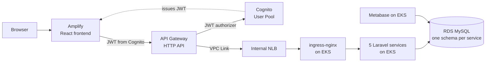
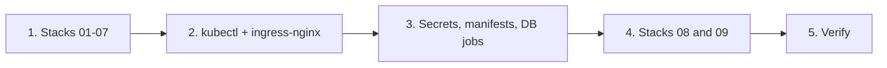

# Wonderland Cloud Platform

A cloud native web platform for the Wonderland theme park, built on AWS.

Visitors can browse rides, book tickets for a date and time slot, pay with a mock payment service and get a digital ticket with a QR code. Administrators can manage rides and ticket prices, record gate check ins and ride usage and monitor park activity through an admin view and a Metabase dashboard.

## Architecture



| Part | Technology |
|---|---|
| Microservices | 5 Laravel 12 apps (PHP 8.2): attraction, pricing, booking, payment, event |
| Database | MySQL 8.4 (Amazon RDS in the cloud), one schema per service |
| Frontend | React (Vite) visitor and admin portals, hosted on AWS Amplify |
| Authentication | Amazon Cognito (`admins` group for administrators) |
| API entry point | Amazon API Gateway HTTP API with a Cognito JWT authorizer |
| Runtime | Docker images on Amazon EKS with ingress-nginx and HPA |
| Analytics | Metabase reading the event data |
| IaC and CI/CD | AWS CloudFormation and GitHub Actions with OIDC |

## Repository structure

```
services/            five Laravel microservices
frontend/            React visitor and admin portals
infrastructure/      CloudFormation templates (01 to 09)
k8s/                 Kubernetes manifests (base, minikube and eks overlays, jobs)
.github/workflows/   CI (ci.yml) and CD (deploy.yml)
scripts/             local .bat scripts and the SQL file
docker-compose.yml   local MySQL
```

## Run locally (Windows)

**Prerequisites:** PHP 8.2, Composer 2, Docker Desktop and Node.js LTS. Only MySQL runs in Docker, on port **3307** (XAMPP MySQL uses 3306).

1. One time setup. This starts MySQL, installs packages, creates the `.env` files and runs the migrations and seeders.
   ```
   scripts\dev-setup.bat
   ```
2. Start everything. One window opens for each service, the booking scheduler and the frontend.
   ```
   scripts\dev-start.bat
   ```
3. Optional: add sample data for the admin dashboard. These rows are marked `source = simulated`.
   ```
   scripts\dev-sample-data.bat
   ```

| Component | URL |
|---|---|
| attraction-service | http://127.0.0.1:8001 |
| pricing-service | http://127.0.0.1:8002 |
| booking-service | http://127.0.0.1:8003 |
| payment-service | http://127.0.0.1:8004 |
| event-service | http://127.0.0.1:8005 |
| frontend | http://localhost:5173 |

Each service has `/up` (for probes) and `/api/health`.

To reset the local database: `docker compose down -v`, then run `scripts\dev-setup.bat` again.

## Tests

Run the tests of a service inside its folder:

```
php artisan test
```

The tests use an in memory SQLite database, so MySQL is not needed for testing.

## Secrets

No secrets are stored in this repository. Each service has a `.env.example` with safe placeholder values. In the cloud, passwords and keys are generated by CloudFormation and kept in AWS Secrets Manager.

## CI/CD

| Workflow | Runs on | What it does |
|---|---|---|
| `ci.yml` | Pull request to `main` | Finds the changed services, runs their tests and Docker build, and builds the frontend |
| `deploy.yml` | Push to `main` | Logs in to AWS with OIDC, builds the five images, pushes them to ECR with the short commit SHA as the tag and rolls them out on EKS |

Amplify builds and deploys the frontend from the `main` branch.

## Cloud deployment

The cloud setup is done manually from PowerShell in the `ap-south-1` region. Replace the values shown as `<LIKE_THIS>` with values from the stack outputs or Secrets Manager. Never commit secret values.

### CloudFormation stacks

| # | Stack name | Template | Creates |
|---|---|---|---|
| 01 | `wonderland-network` | `01-network.yaml` | VPC, public and private subnets in two AZs, one NAT gateway |
| 02 | `wonderland-security` | `02-security.yaml` | Security groups and generated secrets |
| 03 | `wonderland-ecr` | `03-ecr.yaml` | Private ECR repositories for the five services |
| 04 | `wonderland-database` | `04-database.yaml` | RDS MySQL 8.4 in private subnets |
| 05 | `wonderland-eks` | `05-eks.yaml` | EKS cluster, managed node group and add ons |
| 06 | `wonderland-cognito` | `06-cognito.yaml` | Cognito User Pool, app client and `admins` group |
| 07 | `wonderland-cicd` | `07-cicd-iam.yaml` | OIDC role for GitHub Actions |
| 08 | `wonderland-api` | `08-api.yaml` | API Gateway HTTP API, JWT authorizer and VPC Link |
| 09 | `wonderland-frontend` | `09-amplify.yaml` | Amplify Hosting for the frontend |

### Deployment steps



**Prerequisites:** AWS CLI, kubectl, Helm and an active AWS Budget alert.

```powershell
$Region = "ap-south-1"
$Project = "wonderland"
```

**1. Deploy stacks 01 to 07** (one at a time, in order)

```powershell
aws cloudformation deploy --stack-name wonderland-network --template-file .\infrastructure\01-network.yaml --region $Region --parameter-overrides "ProjectName=$Project"
aws cloudformation deploy --stack-name wonderland-security --template-file .\infrastructure\02-security.yaml --region $Region --parameter-overrides "ProjectName=$Project"
aws cloudformation deploy --stack-name wonderland-ecr --template-file .\infrastructure\03-ecr.yaml --region $Region --parameter-overrides "ProjectName=$Project"
aws cloudformation deploy --stack-name wonderland-database --template-file .\infrastructure\04-database.yaml --region $Region --parameter-overrides "ProjectName=$Project" "DbInstanceClass=db.t4g.micro" "MultiAz=false"
aws cloudformation deploy --stack-name wonderland-eks --template-file .\infrastructure\05-eks.yaml --region $Region --capabilities CAPABILITY_NAMED_IAM --parameter-overrides "ProjectName=$Project" "KubernetesVersion=1.36" "NodeInstanceType=c7i-flex.large"
aws cloudformation deploy --stack-name wonderland-cognito --template-file .\infrastructure\06-cognito.yaml --region $Region --parameter-overrides "ProjectName=$Project"
aws cloudformation deploy --stack-name wonderland-cicd --template-file .\infrastructure\07-cicd-iam.yaml --region $Region --capabilities CAPABILITY_NAMED_IAM --parameter-overrides "GitHubOwner=<GITHUB_OWNER>" "GitHubRepo=<GITHUB_REPO>" "ClusterName=wonderland-eks"
```

**2. Connect kubectl and install ingress-nginx** (internal NLB, two replicas)

```powershell
aws eks update-kubeconfig --name wonderland-eks --region $Region
helm repo add ingress-nginx https://kubernetes.github.io/ingress-nginx
helm repo update
helm upgrade --install ingress-nginx ingress-nginx/ingress-nginx --namespace ingress-nginx --create-namespace --values .\k8s\ingress-nginx-values.yaml
kubectl get service ingress-nginx-controller --namespace ingress-nginx --watch
```

**3. Deploy the application**

Create the namespace and the Kubernetes Secrets from the Secrets Manager values:

| Kubernetes Secret | Keys |
|---|---|
| `db-master-secret` | `MASTER_USERNAME`, `MASTER_PASSWORD` |
| `wonderland-app-secrets` | `APP_KEY`, `INTERNAL_TOKEN` |
| `attraction-db-secret`, `pricing-db-secret`, `booking-db-secret`, `payment-db-secret`, `event-db-secret` | `DB_USERNAME`, `DB_PASSWORD` |
| `metabase-db-secret` | `MB_DB_USER`, `MB_DB_PASS` |
| `metabase-ro-secret` | `DB_USERNAME`, `DB_PASSWORD` |

```powershell
kubectl create namespace wonderland --dry-run=client -o yaml | kubectl apply -f -
kubectl create secret generic db-master-secret -n wonderland --from-literal=MASTER_USERNAME='<MASTER_USERNAME>' --from-literal=MASTER_PASSWORD='<MASTER_PASSWORD>' --dry-run=client -o yaml | kubectl apply -f -
kubectl create secret generic wonderland-app-secrets -n wonderland --from-literal=APP_KEY='<APP_KEY>' --from-literal=INTERNAL_TOKEN='<INTERNAL_TOKEN>' --dry-run=client -o yaml | kubectl apply -f -
# Repeat the same command for each database secret in the table above.
```

Copy the manifests to `build/k8s/` and replace the three tokens (`__ECR_REGISTRY__`, `__IMAGE_TAG__`, `__DB_HOST__`):

```powershell
Copy-Item -Path .\k8s -Destination .\build\k8s -Recurse -Force
$EcrRegistry = aws cloudformation describe-stacks --stack-name wonderland-ecr --region $Region --query "Stacks[0].Outputs[?OutputKey=='RegistryUri'].OutputValue | [0]" --output text
$ImageTag = git rev-parse --short=7 HEAD
$DbHost = aws cloudformation describe-stacks --stack-name wonderland-database --region $Region --query "Stacks[0].Outputs[?OutputKey=='DbEndpoint'].OutputValue | [0]" --output text
Get-ChildItem .\build\k8s -Recurse -File | ForEach-Object {
    $c = [System.IO.File]::ReadAllText($_.FullName)
    $c = $c.Replace("__ECR_REGISTRY__", $EcrRegistry).Replace("__IMAGE_TAG__", $ImageTag).Replace("__DB_HOST__", $DbHost)
    [System.IO.File]::WriteAllText($_.FullName, $c, [System.Text.UTF8Encoding]::new($false))
}
```

Create the schemas, then apply the EKS overlay (services, migrate Jobs and Metabase):

```powershell
kubectl apply -f .\build\k8s\jobs\db-bootstrap-job.yaml
kubectl wait --for=condition=complete job/db-bootstrap --namespace wonderland --timeout=300s
kubectl apply -k .\build\k8s\overlays\eks
kubectl get pods --namespace wonderland
```

**4. Deploy API Gateway and Amplify**

```powershell
$NlbDns = kubectl get service ingress-nginx-controller --namespace ingress-nginx -o jsonpath='{.status.loadBalancer.ingress[0].hostname}'
$NlbArn = aws elbv2 describe-load-balancers --region $Region --query "LoadBalancers[?DNSName=='$NlbDns'].LoadBalancerArn | [0]" --output text
$ListenerArn = aws elbv2 describe-listeners --load-balancer-arn $NlbArn --region $Region --query 'Listeners[?Port==`80`].ListenerArn | [0]' --output text
aws cloudformation deploy --stack-name wonderland-api --template-file .\infrastructure\08-api.yaml --region $Region --parameter-overrides "ProjectName=$Project" "NlbListenerArn=$ListenerArn" "AllowedOrigins=http://localhost:5173"

aws cloudformation deploy --stack-name wonderland-frontend --template-file .\infrastructure\09-amplify.yaml --region $Region --parameter-overrides "ProjectName=$Project" "GitHubRepoUrl=<GITHUB_REPO_URL>" "GitHubToken=<GITHUB_TOKEN>"
$AmplifyUrl = aws cloudformation describe-stacks --stack-name wonderland-frontend --region $Region --query "Stacks[0].Outputs[?OutputKey=='AmplifyUrl'].OutputValue | [0]" --output text

# Allow the Amplify site in CORS
aws cloudformation deploy --stack-name wonderland-api --template-file .\infrastructure\08-api.yaml --region $Region --parameter-overrides "ProjectName=$Project" "NlbListenerArn=$ListenerArn" "AllowedOrigins=http://localhost:5173,$AmplifyUrl"
```

**5. Verify**

```powershell
kubectl get pods,hpa,pdb,cronjobs,ingress --namespace wonderland
$ApiUrl = aws cloudformation describe-stacks --stack-name wonderland-api --region $Region --query "Stacks[0].Outputs[?OutputKey=='ApiUrl'].OutputValue | [0]" --output text
curl.exe -i "$ApiUrl/api/attractions"     # expected 200
curl.exe -i "$ApiUrl/api/bookings/me"     # expected 401 (no token)
```

Open Metabase with port forwarding, then go to http://localhost:8088:

```powershell
kubectl port-forward --namespace wonderland service/metabase 8088:3000
```

### Clean up

Remove ingress-nginx first so its NLB is deleted, then delete the stacks in reverse order. Stack 06 (Cognito) can be kept because it has no running cost.

```powershell
helm uninstall ingress-nginx --namespace ingress-nginx
foreach ($s in "wonderland-frontend","wonderland-api","wonderland-cicd","wonderland-eks","wonderland-database","wonderland-ecr","wonderland-security","wonderland-network") {
    aws cloudformation delete-stack --stack-name $s --region $Region
    aws cloudformation wait stack-delete-complete --stack-name $s --region $Region
}
```

If the ECR stack fails to delete, delete the images in the repositories and try again. Finally, check that no NLB, NAT gateway or EBS volume is left.

## Future work

- Deploy and destroy scripts to automate the manual cloud steps
- Pod log collection to CloudWatch
- Cluster Autoscaler and a cloud load test
